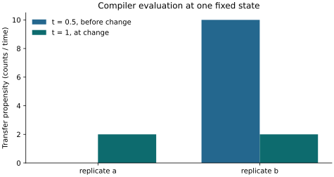

# Capabilities and executable examples

`op_system` compiles model definitions. An engine advances state and a provider
adapts a framework's lifecycle. The MIT core does not import flepimop2; the
separate GPL `flepimop2-op_system` distribution shares its release version.

## Model classes and numerical representations

| Model class | Specification/compiled contract | Numerical consumer owns |
| --- | --- | --- |
| Spatial or trait-structured PDEs | Continuous axes, shaped fields and [transport/diffusion operator metadata](operators.md) | Geometry, boundary treatment, discretization and integration |
| Nonlocal / integro-differential dynamics | Kernel reductions and conservative [jump-integral contracts](operators.md#jump-integrals) | Kernel values, quadrature/discretization and operator staging |
| ODEs and compartmental flows | Expression equations or named transitions and flat/PyTree evaluators | Time integration and accuracy policy |
| Stochastic reaction networks | Named reaction channels, propensities, dependencies and reported gaps | Event/leap method, complete dynamics coverage and random streams |

A PDE field represented on a numerical grid becomes a finite array. That array
representation retains spatial/trait coordinates, measures, kernels and operator
semantics; a right-hand-side callable is one part of the compiled contract.
The SEIR and transfer examples below introduce model authoring. The operator
guide covers spatial and nonlocal terms.

## Choose a public interface

| Task | Implemented interface | Example and boundary |
| --- | --- | --- |
| Check or compile a specification | `validate_spec`, `normalize_rhs`, `compile_spec`, `compile_rhs` | [Getting started](getting-started.md): expression and transition SEIR; validation is structural, not proof of scientific correctness. |
| Export model IR and bounded derivatives | `export_ir`, `symbolic_derivatives`, `export_julia` | [Portable IR](portable-ir.md); typed data, native scalar derivative matrices and explicit Julia bindings. Tensor/operator compositions and external-tool rank conclusions are separately qualified. |
| Evaluate flat or structured state | `CompiledRhs.eval_fn`, `pytree_eval_fn` | [State representations](state-representations.md); use declared template shapes and state order. |
| Export conservative dependencies | `dependency_structure` | [Dependency structure](dependency-structure.md); bounded current-state/buffer reads, grouped observable shapes and existing block proofs, with explicit unsupported coverage. |
| Evaluate independent blocks | `factorize_axes`, `block_pytree_eval_fn` | [Independent batches](batched-models.md); reductions or mixing across a proposed block axis invalidate independence. |
| Export stochastic channels | `CompiledRhs.reactions`, `reaction_gaps`, `CompiledReaction` | Named transitions, reactants/dependencies and declared state shapes; a stochastic consumer must reject omitted dynamics. |
| Resolve forcing once | `resolved_propensity_fn`, `time_varying_params`, `uses_time`, `independent_axes` | [Time tables](time-indexed-parameters.md) and [batches](batched-models.md); the consumer supplies correctly sliced parameters. |
| Compute named latent quantities | `CompiledRhs.observables`, `CompiledObservable` | [Latent observables](latent-observables.md): coordinates, reductions and physical measures; observation noise belongs downstream. |
| Integrate selected positive states in log coordinates | `CompiledRhs.coordinate_view()`, `StateCoordinateView` | [Log state coordinates](log-state-coordinates.md); deterministic expressions and transitions with explicit encoding/decoding and domain flags. |
| Inspect and fix shared scaling freedoms | `CompiledRhs.gauges`, `gauge_fix` | [Scaling gauges](scaling-gauges.md); finite covariance probes and conservative homogeneity detection are not structural identifiability proofs. |
| Inspect conditional conservation | `reaction_balances` | [Reaction balances](reaction-balances.md); respect reported gaps, parameter/sign assumptions and representation. |
| Check independently specified equations | `qualify_rhs`, `QualificationFixture`, `QualificationConfig` | [Numerical qualification](numerical-qualification.md); parity and invariant evidence is limited to the supplied fixtures. |
| Supply spatial/operator metadata | `OperatorDescriptor`, axis measures, kernels | [Operators](operators.md); discretization and solving belong to a numerical engine. |

NumPy, JAX and CPU Torch have a required [qualification matrix](backend-qualification.md).
Array namespace selection happens at evaluation time. GPU execution and other
Array API implementations need separate qualification for the intended model.
`convolve_history` has a provider hook; `history` and `delay` remain reserved,
unsupported operators. Metadata does not certify positivity or a physical model.

## Run the combined compiler example

From a source checkout:

```bash
uv sync --dev
just example-reactions
just doctest
```

[`examples/independent_reactions.py`](https://github.com/ACCIDDA/op_system/blob/main/examples/independent_reactions.py)
validates a two-replicate transfer model, compiles a held rate table and evaluates
a named population observable. The independently known derivatives are
`[0, -10, 0, 10]` before the forcing change and `[-2, -2, 2, 2]` at it; each
replicate keeps its own population, 10 or 20. This evaluates the compiler;
[op_engine](https://github.com/ACCIDDA/op_engine) provides independent-clock SSA.

### Read the compiled output



--8<-- "docs/assets/compiled-transfer/summary.txt"

The state stays fixed at `S = [10, 20]`, `I = [0, 0]` in both evaluations.
The bars compare compiled propensities at two times. At `t = 1`, the
right-continuous table selects its new row. Each transfer has opposite drift
contributions to S and I, preserving its own population. No integration is
performed in this compiler example.

[Download the vector PDF](../assets/compiled-transfer/figure.pdf).
Regenerate the figure and table from the actual checked example:

```bash
uv run --with matplotlib==3.11.2 python examples/illustrate_reactions.py
just figures-check
```

Matplotlib is needed only for regeneration. The check reruns the compiler
fixture, compares the table and full plotted data, and verifies source/export
fingerprints. The docs build runs that check and includes the generated table
directly. The [plotted data](../assets/compiled-transfer/data.json) records the
numerical inputs.

A scalar template has shape `()`. To evaluate replicated reactions, declare a
replicate axis in the specification. A leading dimension on scalar state does
not create one. Held tables are right-continuous; exact frozen-rate SSA also
requires no continuous time dependence between changes.

## What runs automatically

`just doctest` runs public API examples and the actual README/SEIR guide code,
including the standalone example. `just ci` includes those tests plus the
broader core/provider suite, strict typing, lint and documentation checks.
Public docstrings cover compilation, reaction shape metadata, balances and
independent-equation qualification. They use small deterministic results;
backend differentiation and broader conformance remain in dedicated tests.

When changing an API or example, update its guide and docstring together. Keep
complete workflows executable, assert an independent equation or invariant,
and run the real documentation text rather than a copied test-only version.
Run `just qualify` and `just build-all` before a PR as described in
[Contributing](../development/contributing.md).
