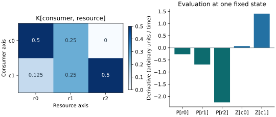

# Named-axis kernel products

Two different axes can index a rectangular parameter table. For example,
`K[consumer,resource]` has one row for each consumer and one column for each
resource. State arrays need not have the same length. The named selectors
identify which axis is summed, including when the matrix is used in the
opposite direction.

| Expression | Independent array calculation |
| --- | --- |
| `apply_along(K[consumer,resource:r]*P[resource:r], resource=r, kernel=sum)` | `K @ P` |
| `apply_along(g[consumer:c]*K[consumer:c,resource]*Z[consumer:c], consumer=c, kernel=sum)` | `K.T @ (g * Z)` |

The normalizer infers the parameter's axis order from its named references;
`validate_spec(spec).parameters` reports the contract. Supply `K` with the
reported shape and order. Distinct axis names make the intended row/column
roles explicit, rather than relying on equal lengths to conceal a transpose.

The complete executable example includes both products and a per-coordinate
choice of linear or quadratic loss:

```{.python}
--8<-- "examples/named_kernel_products.py"
```

Run `uv run python examples/named_kernel_products.py`. The example compares
the compiled derivative with a separate NumPy implementation. Required
backend qualification tests rectangular cases in NumPy, JAX and CPU PyTorch;
JAX JIT and derivatives and PyTorch kernel gradients have independent checks.

## A fixed-state example



This synthetic example evaluates one state; it does not integrate a trajectory.
Its binary-exact inputs are retained with the generated figure. The two
consumer entries use different declared loss choices.

--8<-- "docs/assets/named-kernels/summary.txt"

[Vector PDF](../assets/named-kernels/figure.pdf) · [Inputs and outputs](../assets/named-kernels/data.json)

## Conditional selection

`np.where(condition, a, b)` selects elementwise and dispatches through the
state's array namespace. Conditions and branches can use shaped parameters,
states and aliases. A condition such as `linear[consumer] > 0` chooses the
formula separately for each consumer.

Both branch expressions are evaluated. This is not lazy control flow: an
inactive branch can still divide by zero, overflow or produce invalid gradients.
Write expressions with valid numerical domains on both branches. Boolean
parameters here choose between formulas; they do not create a stochastic event
or change the reaction-network interpretation.

## Lowering and cost

For a single unweighted, unfiltered reduction over one axis and one free
output axis, the compiler recognizes a two-axis matrix multiplied by a
one-axis vector or vector product. It emits namespace-native `matmul`, avoiding
the broadcast matrix-vector temporary. Named axes supply the transpose when
needed. More general layouts, weighted quadrature, filtered sums and repeated
physical-axis forms retain the general reduction path.

Vectorized flat and PyTree evaluators cache generated expression functions at
compile time. Each call binds fresh state and parameter values; it does not
invoke `eval` for each alias or equation. State/parameter shape checks and
namespace discovery still have per-call costs. Scalar fallback evaluation is
unchanged, and small problems can still spend more time in dispatch than in
arithmetic. No runtime speed ratio is guaranteed.

An optional warmed NumPy comparison records compilation separately from
evaluation and checks the independent equations before timing:

```shell
OPENBLAS_NUM_THREADS=1 OMP_NUM_THREADS=1 uv run python -m \
  scripts.benchmark_named_kernels --sizes 4 16 128 256 512 1024
```

Large normalization cases can consume substantial time and memory. Start with
the default smaller sweep when exploring a machine. These measurements are
outside CI; CI checks numerical behavior and contraction structure without a
wall-time threshold.
